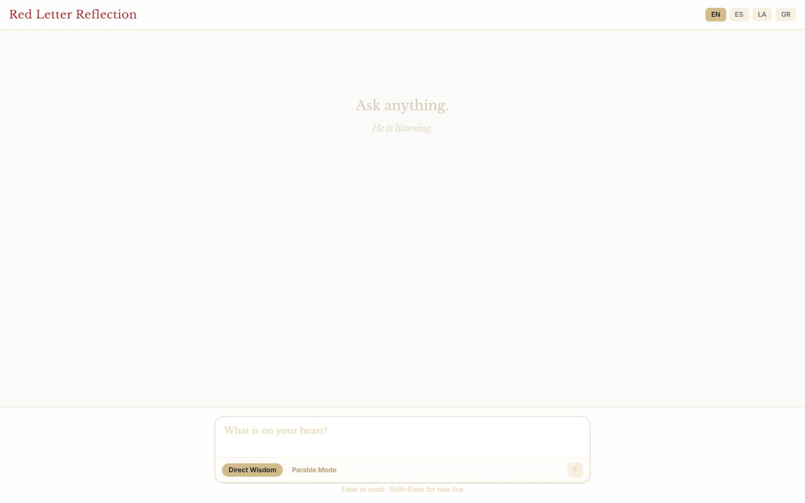
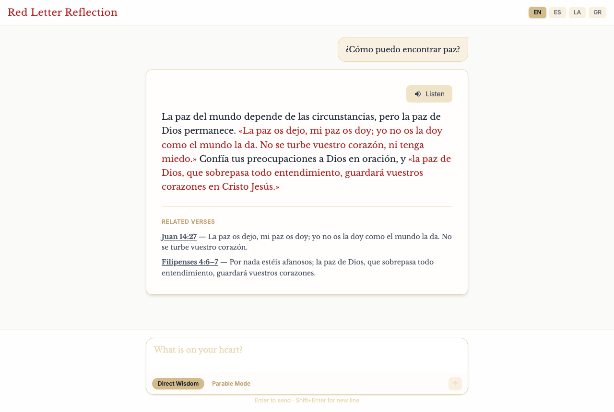
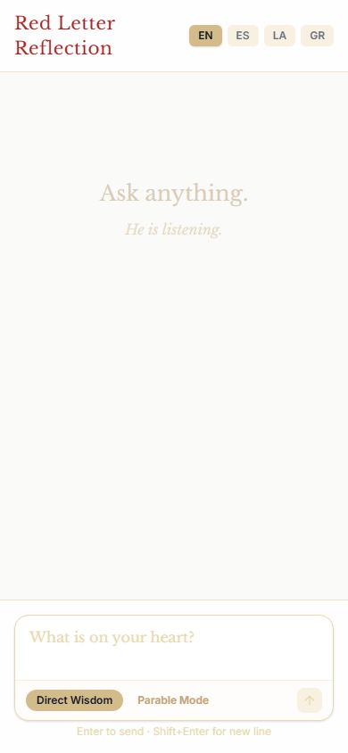

# JesusGPT (Red Letter Reflection)

Chat de estudio bíblico con inteligencia artificial. Haces una pregunta y la respuesta llega en primera persona, con la voz de Jesús, basada solo en los versículos de los Evangelios. Está pensado para quien quiere reflexionar con el texto bíblico en inglés, español, latín o griego.

Sitio en vivo: https://jesus-gpt.vercel.app

## Qué hace

- Responde de forma directa o con una parábola original, según el modo que elijas.
- Busca primero los versículos más relevantes y solo esos se le pasan al modelo, así no inventa doctrina.
- Muestra los versículos relacionados debajo de cada respuesta.
- Funciona en inglés, español, latín y griego desde un mismo conjunto de datos.
- Lee las respuestas en voz alta con la Web Speech API del navegador.
- Usa Gemini como modelo principal y Groq (`llama-3.3-70b-versatile`) como respaldo.

## Tecnologías

React 19, Vite, Tailwind 4, Express, Gemini, Groq, desplegado en Vercel con una función serverless.

## Capturas







## Cómo correrlo en local

```bash
npm install
cp server/.env.example server/.env
npm run extract
npm run dev
```

El servidor queda en el puerto 3001 y el cliente en el 3000. El comando `npm run extract` genera `server/data/gospels.json` y hay que correrlo una vez antes del primer arranque.

Variables de entorno en `server/.env`:

- `GEMINI_API_KEY` (obligatoria)
- `GROQ_API_KEY` (opcional, respaldo)
- `PLAYHT_API_KEY` y `PLAYHT_USER_ID` (opcionales, reservadas para voz en el servidor)
- `PORT` (opcional, por defecto 3001)

## Estructura

- `client/`: aplicación React con Vite.
- `server/`: servidor Express para desarrollo, con la búsqueda de versículos en `services/ragEngine.js` y el cliente de modelos en `services/geminiClient.js`.
- `api/index.js`: entrada serverless para Vercel con `/api/reflect` y `/api/health`.

## Licencia

[MIT](LICENSE)
